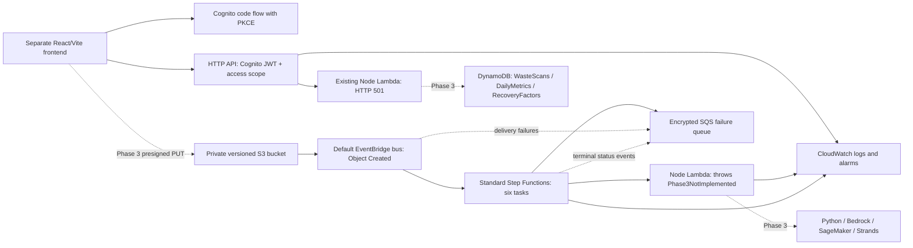

# Architecture

## Phase 2 status

AWS CDK v2 TypeScript now defines five stacks and can synthesize them locally.
Nothing is deployed. The frontend remains the static Phase 1 page and will be hosted
separately. API routes use the existing HTTP 501 placeholder; Python AI/agent
boundaries remain unimplemented. No model calls or recovery calculations exist.

Solid AWS connections are IaC definitions; dashed business integrations remain
deferred. None represents a deployed connection.

## Stack boundaries

| Stack                        | Responsibility                                                          | Dependencies     |
| ---------------------------- | ----------------------------------------------------------------------- | ---------------- |
| Waste2WattDataStack          | Image bucket and three DynamoDB tables                                  | None             |
| Waste2WattAuthStack          | User pool, public web client, resource-server scope, login domain       | None             |
| Waste2WattApiStack           | HTTP API, JWT authorizer, nine routes, bundled API Lambda               | Auth             |
| Waste2WattPipelineStack      | Standard workflow, placeholder worker, failure queue, EventBridge rules | Data             |
| Waste2WattObservabilityStack | Lambda, execution, delivery, and queue alarms                           | API and Pipeline |

Log groups live with their producers to prevent a circular dependency.
CDK automatically generates CloudFormation exports/imports for cross-stack references.
No account discovery, VPC lookup, frontend hosting, SageMaker endpoint, or Bedrock
invocation is needed for synthesis.

## Image workflow

Native S3 EventBridge notifications feed the default bus. A rule accepts only Object
Created events from this image bucket with keys under uploads/. It passes the S3
event to the workflow; it does not accept arbitrary client-supplied analysis events.

ValidateImage → ClassifyWaste → VerifyWithBedrock → RecoveryEngine → PersistResult
→ UpdateDailyMetrics are six Lambda Task states. One safe worker stands in for their
future implementations and always throws. Each task catches failures, writes a
diagnostic to SQS, and ends in Fail. A final guard also records failure if a placeholder
ever unexpectedly returns. No success result, classification, or energy estimate is fabricated.

EventBridge target-delivery failures also use the queue. A second rule forwards
workflow FAILED, TIMED_OUT, and ABORTED status events, covering failures outside
task-level catches. A caught failure can produce both a detailed message and a
terminal-status event; Phase 3 consumers must deduplicate by execution ARN.

## Deferred boundaries

Python analysis workers, Strands decision tools, Bedrock/SageMaker access, input
schemas, ownership enforcement inside handlers, scan status transitions, replay,
idempotency, evidence validation, and science-backed recovery calculations belong
to Phase 3. Existing shared models are provisional contracts; API scan identifiers
will be mapped to their sample identifiers during service implementation.

See [data model](DATA_MODEL.md) and [Phase 2 decisions](PHASE2_INFRASTRUCTURE.md).
