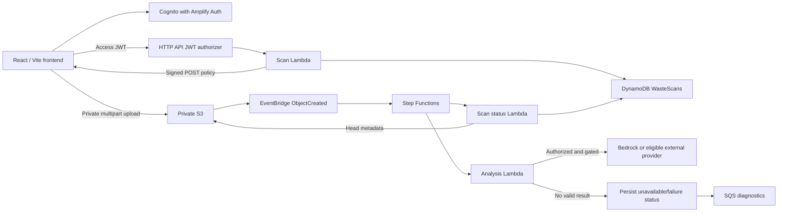

# Architecture

Waste2Watt AI is hosted on AWS Amplify and backed by five AWS CDK application stacks.
The live system uses Cognito, API Gateway, Lambda, DynamoDB, private S3, EventBridge,
Step Functions, SQS, and CloudWatch. Deployment and acceptance evidence is recorded
in the Phase 4 and Phase 5 reports. The account's Bedrock access remains blocked;
external provider routing is guarded by the documented zero-cost policy, and hosted
analysis has returned both a validated result and `ANALYSIS_UNAVAILABLE` outcomes.

## Stack boundaries

Data owns the private versioned bucket and three retained/PITR DynamoDB tables.
Auth owns the email Cognito pool, public SRP-capable client, resource server and
future hosted-login domain. API references Auth and Data, owning nine protected
routes, scan Lambda and access logs. Pipeline references Data, owning the status
worker, analysis Lambda, workflow tasks, EventBridge rules,
state machine and failure queue. Observability references API/Pipeline and
defines seven alarms. Strong export/import references avoid dependency cycles.

The existing OwnerCreatedAt index already supports user history, so no table
redesign was required. Other tables are unchanged.

## Authentication

Amplify Auth and its managed Authenticator implement sign-up, email confirmation,
sign-in, forgot/reset password and applicable MFA challenges. The provider
restores sessions through SDK APIs and Auth Hub events; protected routes show a
loading state and redirect anonymous users to /auth, preserving a safe destination.
Sign-out uses the SDK. No password or token is manually persisted.

Amplify owns CookieStorage with SameSite=Strict and Secure on HTTPS. Local HTTP
loopback uses non-Secure cookies for development. These browser-managed cookies
are JavaScript-readable, not HttpOnly; the app uses HTTPS, CSP, and hosting security
headers, but this is not a server-session/BFF design.

Native SRP access tokens use aws.cognito.signin.user.admin; HTTP API requires
that scope and the configured client audience. Lambda independently checks
access token_use/client_id and derives identity from trusted Gateway claims.
The existing custom OAuth resource scope is retained for a future hosted-login
flow. The client also permits the reserved scope in a future code flow. See
[AWS Cognito authentication flows](https://docs.aws.amazon.com/cognito/latest/developerguide/authentication-flows-public-server-side.html)
and [Amplify token storage](https://docs.amplify.aws/react/build-a-backend/auth/concepts/tokens-and-credentials/).

## Upload and status flow

The browser validates MIME/size, previews a local blob and collects approximate
kg plus an optional source label. It creates an owned scan, obtains constrained
credentials, and POSTs the image directly to S3 with progress reporting.
No image passes through API Gateway. Keys are generated on the server.
XHR requests can be aborted; polling is bounded, cancels on unmount and supports
manual refresh after stopping.

S3 events match this bucket and private/ prefix. ValidateImage now verifies
ownership/key and version-specific metadata and persists UPLOADED/PROCESSING.
It performs no image-content or malware inspection. The analysis Lambda applies
provider eligibility, cost, timeout, and schema gates before persisting a result.
Unavailable and execution-failure paths persist explicit statuses; they do not
claim successful analysis. Terminal state-machine failure events reach the
failure queue and status updater.

Conditional writes protect terminal statuses against duplicate events. They are
not complete exactly-once processing; full image-version idempotency, recovery
and reconciliation are deferred. Bedrock is not invoked while its access gate is
blocked. The local image benchmark is not connected to hosted scan persistence,
the deterministic advisor does not instantiate a hosted language-model agent,
and no SageMaker endpoint is deployed.

## Frontend and operational boundaries

Public landing and Cognito auth pages accompany seven protected pages:
dashboard, scan, history, digital twin, simulator, advisor and settings.
The UI uses a graphite and violet visual theme, semantic HTML, keyboard focus, text
statuses, mobile layouts, reduced-motion handling, loading/error/empty states, and
an error boundary. Dashboard, scan, history, Digital Twin, simulator, advisor, and
settings pages are implemented. Reports keep unavailable values explicit. Missing
real AWS configuration yields a developer screen, not mock accounts or data.

API IAM permits only WasteScans Get/Put/Update, Query on its specific GSI and
PutObject under private/*. The status role permits scan Get/Update and private
GetObject/GetObjectVersion because HeadObject requires these actions. API and
status roles cannot use unrelated tables or AI services; the separate analysis
role's Bedrock and secret access are narrowly scoped. Prefix wildcards cover
server-generated object IDs; CloudWatch delivery APIs that do not support
resource scoping remain documented in the Phase 2 report.

CloudWatch logs retain 30 days; state-machine log events exclude execution data,
and application/access log formats exclude JWTs and sensitive headers. Existing
Lambda, HTTP API, state-machine, and queue alarms are supplemented by status-worker
errors. Notification destinations remain unset. Amplify Hosting is the deployed
frontend. Current provider gates and known limitations are tracked in the
[completion report](FINAL_COMPLETION_TRACKER.md) and
[provider policy](AI_PROVIDER_FREE_ONLY.md). Scientific factors remain unconfigured,
so energy and carbon impact are not estimated.
