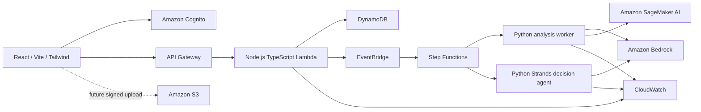

# Architecture

## Current state

Only local scaffolding exists. The React page does not call an API. The Lambda-shaped
handler returns HTTP 501 for every invocation. Python analysis and agent adapters
raise `NotImplementedError`. Infrastructure has only a configuration interface and
cannot synthesize or deploy. No AWS clients, cloud resources, trained models, or
sustainability factors are included.

## Planned system

This diagram is design intent. No arrow represents an implemented integration.
EventBridge and Step Functions will coordinate asynchronous work; the frontend will
read job state from the API. Detailed orchestration and model selection remain open.
CDK v2 TypeScript will define infrastructure after authorization.

## Boundaries

- Web: presentation; future Cognito sign-in and API client.
- API: authentication/ownership enforcement, metadata, upload signing, job requests.
- Analysis: evidence-aware waste analysis and model inference.
- Agent: contextual decisions using Strands with Bedrock; retain evidence and limitations.
- ML: datasets, training, evaluation, model versions, and SageMaker entrypoints.
- Shared: transport/domain contracts; no infrastructure or calculations.
- Infra: resource definitions and deployment configuration in a future phase.

## Decisions deferred

Dataset sourcing, waste taxonomy, model selection, supported energy pathways,
measurement requirements, scientific conversion methods, cost limits, retention,
frontend hosting, and regional service availability require later decisions.
Pathway identifiers in the contracts are provisional design vocabulary, not claims
that those options are appropriate for any given waste sample.

Future integrations must validate inputs at runtime, derive owner identity from
Cognito, use least-privilege IAM, protect S3 access, handle retries/idempotency, and
emit structured CloudWatch logs with correlation IDs. These controls are not implemented.
