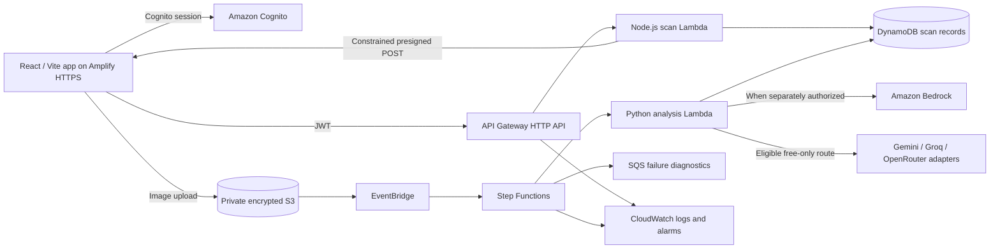

# Technical overview

## Trust and data boundaries

- Cognito authenticates users. Protected API handlers validate the JWT and derive the owner from trusted identity claims; browser-supplied owner IDs are not authoritative.
- The API issues a constrained upload policy for server-generated keys in a private S3 prefix. The image bypasses API Gateway, which avoids sending the binary through the request handler.
- DynamoDB records are owner-scoped. S3 public access is blocked; image reads use authorized application flows.
- The analysis handler validates a structured response before it becomes a report. Missing, malformed, unavailable, or unsupported values remain unavailable. It does not infer weight, safety, facility acceptance, energy, or carbon from pixels.
- Bedrock is skipped while AWS model access is unauthorized. External providers require backend-only credentials and pass the free-only, zero-price safeguards; a provider failure can produce `ANALYSIS_UNAVAILABLE`.
- Dashboard/Twin numbers describe recorded account data. Simulator values are calculations from user-entered, cited assumptions and remain labeled simulated. Advisor suggestions are deterministic and read-only.

## Infrastructure and operations

Five CDK v2 stacks cover Data, Auth, API, Pipeline, and Observability. S3 events start Step Functions; Lambda persists workflow status; the existing SQS queue retains diagnostics. CloudWatch collects application/workflow logs and alarms. Amplify serves the React/Vite monorepo build over HTTPS and rewrites application routes to the SPA entry point.

No SageMaker endpoint is deployed. The trained local image baseline is not wired into production scans. The existing failure queue and its alarm are operational resources; this submission does not alter its messages or configuration.

## Research reproducibility

The local model run used 977 deduplicated images from the publisher-listed CC BY 4.0 Mendeley release, with a deterministic split that held one publisher source group out. Held-out accuracy was 45.38% and macro-F1 was 28.15%; test coverage omitted Glass and included four Paper images. The result is incomplete and unsuitable for production. TrashNet++ and RealWaste were excluded over unresolved image-use rights. Dataset provenance and limitations are in [the model report](../docs/PHASE6_LOCAL_MODEL_REPORT.md).
